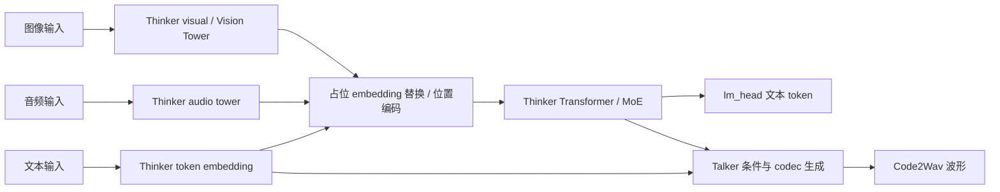
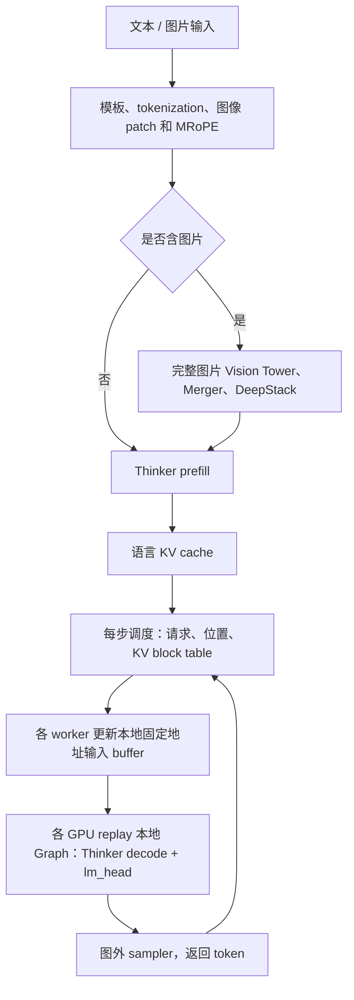
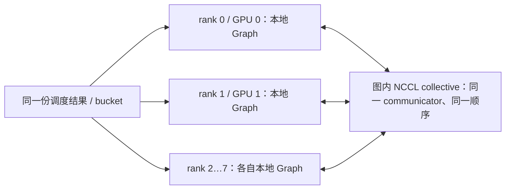
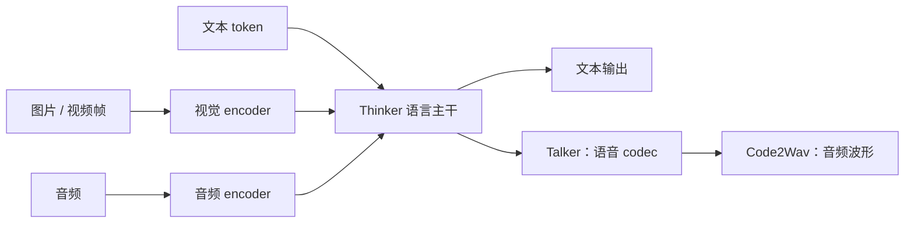

# CUDA Graph、数值正确性与多模态路径说明

更新日期：2026-11-08（持续补充真实服务器验证）。

这份说明把三个问题分开：CUDA Graph 是否真的执行、batch-invariant 为什么存在、Qwen3-Omni 的图像输入到底如何进入当前自研引擎。结论严格区分已经有证据的内容和还没有完成的验证。

## 1. 当前到底测试到了什么

上一会话的严格验证在 8 张 A800-SXM4-80GB 上执行，配置是 TP8、EP8、DP1、PP1、BF16、Qwen3-Omni Thinker。测试同时比较了：

1. 实际 batch 的 eager；
2. 补齐到 CUDA Graph bucket 后的 eager；
3. 补齐 bucket 后的 CUDA Graph replay。

使用随机前缀、17/255/256/511 等上下文长度、连续多步 decode、请求重排，并恢复独立 KV 快照逐项比较。最终证据目录是 `outputs/mm_graph_fix_20261107/graph_batch_invariant_kv_checked/`，结果包括：

- 256 个 rank-step 全部通过；
- 完整词表 logits `max_abs = 0`；
- 补齐 eager、Graph replay、未补齐 eager 在严格策略下逐位一致；
- 有效 KV cache 逐位一致；
- 请求反转后再恢复顺序，输出逐位一致；
- rank0 的记录显示实际 Graph replay 次数为 65，说明不是只在配置里打开而实际走 eager。

2026-11-08 已恢复服务器连接，并在独立完整源码快照上复测新增生命周期保护。复测先修复了一个初始化回归：模型 warmup 的 decode 发生在 Graph capture 之前，不能被“缺失 bucket 禁止 eager”的正式运行保护拦截；仅初始化 warmup 允许 eager。另在每个 bucket 的 warmup CUDA synchronize 后增加 rank barrier，防止部分 rank 开始 capture 时其它 rank 仍在提交 warmup collective。

新增实际硬件证据：8×A800-SXM4-80GB，PyTorch 2.14.1、CUDA 13.0、TP8/EP8、BF16。逐 rank JSON、源码 SHA256、完整命令及日志保存在本文同目录的 `graph_verified/`，原始归档为 `graph_verified_evidence.tar.gz`。

| 测试 | batch | 上下文前缀 | 连续 decode | rank-step 比较 | 每 rank replay | 结果 |
|---|---|---|---:|---:|---:|---|
| strict_small，seed 983 | 1–8 | 混合 17/255/256/511 | 4 | 256 | 64 | 全部通过 |
| strict_large，seed 1949 | 1/8/9/16/17/32/33/64/65/127/128/129/255/256 | 混合 17/255/256/511 | 4 | 448 | 112 | 全部通过 |

以上两次均启用随机 token 前缀和请求顺序反转。所有 rank 的补齐 eager、未补齐 eager、Graph logits 最大差均为 0；KV 对比、跨 rank logits 对比、重排 logits 对比和 capture 不污染有效 KV 的哨兵检查全部通过。大批量测试捕获 bucket 为 1/2/4/8/16/32/64/128/256，记录的每 rank Graph 常驻显存增量为 268,435,456 bytes（256 MiB）。其 34,177,342,464 bytes 峰值包含测试使用的多份完整 KV 快照，不能当作正常服务峰值。

这些是有限负载下的严格回归证据，不证明任意模型、拓扑和上下文的普遍正确性，也不等于完成了 128/256 并发在线/离线吞吐评测。后者仍需真实数据、HTTP 服务和持续补充请求的负载实测。

本机已通过：

```text
python -m compileall -q v9
python v9/tools/benchmark.py --help
git diff --check
```

## 2. 为什么普通 CUDA Graph 会出现精度变化

一个请求实际有 3 行 token，但最小 Graph bucket 可能是 4。为了让 Graph 的张量形状固定，系统会补出第 4 行：

- 有效请求使用真实 `input_id`、位置、上下文长度和 block table；
- 补齐行使用 dummy token、长度 1、`slot = -1` 和专用零 KV block；
- Graph 最后只返回前 3 行 logits。

从数学上看，每一行是独立的，但 GPU 数值库不一定对不同的矩阵形状采用相同的算法。形状从 M=3 变成 M=4 后，可能发生：

- BF16 GEMM 的 tile 划分和累加顺序变化；
- NCCL reduction 的消息形状和归约树变化；
- RMSNorm 的并行归约顺序变化；
- MoE router 前面出现一个很小的差异后，top-k 专家选择被离散放大。

上一轮排查得到的首处分歧正是这类问题：3→4 时先出现在 BF16 TP reduction，7→8 时又暴露了 BF16 本地 GEMM 和 RMSNorm 的形状敏感性。把 TP reduction 临时改成 FP32 只能修复其中一组，不能解决所有情况。

## 3. batch-invariant 数值策略是什么

它不是“把整个模型改成 FP32”，也不是“关闭 CUDA Graph”。它是一组在显式启用此策略的引擎中使用的固定数值原语，目标是让 M=3 和 M=4 对同一有效行采用同一套计算顺序。该环境开关也会影响该进程内的 eager 线性层和 prefill，不能把开启 Graph 加严格策略、与关闭 Graph 且关闭严格策略的差别都算成 Graph 本身的影响。

当前实现位于 [batch_invariant.py](../v9/layers/batch_invariant.py)：

### 固定 GEMM

自定义 Triton GEMM 固定 BM=16、BN=64、BK=32，并固定 K 维分块累加顺序。这样矩阵多出 padding 行时，已有行不会因为 M 改变而换一套 GEMM tile 算法。

### 固定 TP/EP 归约

普通路径可以直接 `all_reduce`。严格路径先用 NCCL 做数据收集，再在 GPU 上按照 rank 0、rank 1、……的固定顺序用 FP32 累加。通信仍然发生在 GPU 上，但最终求和顺序不随消息形状改变。

### 固定专家和 RMSNorm 归约

MoE 专家贡献按固定专家顺序累加；RMSNorm 使用固定行内归约；相关 SiLU 和线性层也走固定数值路径。

代价是临时 buffer、通信量和 kernel 性能开销都可能增加，所以它不是通用加速策略，而是 Graph padding 的正确性策略。

另有 `batch_execution_mode=per_request`，它把每个请求分别 forward，以牺牲批处理融合来保持单请求形状；这与上述固定 tile 的 batch-invariant 策略不同。本轮负载测试使用 `batched` 加固定数值策略。为避免在同一进程中继承前一次引擎设置的环境变量，Graph/eager 性能对照使用独立进程，并记录实际全部 `VLLM_LEARN_*` 参数。

现在 Graph 请求默认自动打开严格策略：

```bash
python v9/tools/benchmark.py --decode-graph
```

等价的关键环境变量是：

```bash
VLLM_LEARN_DECODE_GRAPH=1
VLLM_LEARN_DECODE_GRAPH_STRICT=1
VLLM_LEARN_BATCH_INVARIANT=1
```

只有明确设置 `VLLM_LEARN_DECODE_GRAPH_STRICT=0` 才会允许形状敏感的快速消融。这个快速模式可以运行，但不能承诺未补齐 eager、补齐 eager 和 Graph replay 逐位一致。

## 4. 并行 CUDA Graph 是怎么捕获的

当前每个 GPU worker 在自己绑定的 GPU 上，按 bucket 分别捕获本地 CUDA Graph；所有 worker 按相同顺序进入捕获。Graph 对象属于本地 CUDA context。

以 TP8/EP8、8 张 GPU 为例：

1. 启动 8 个 worker 进程；每个进程绑定一张 GPU，并持有该 rank 的 TP/EP 权重和 KV cache。
2. 每个进程都构造相同的 bucket，例如 1、2、4、8……，但 Graph 对象和静态输入 buffer 都是该进程本地的 CUDA 对象。
3. 每个进程在捕获前设置相同的静态输入形状：`ids`、`positions`、`slot_mapping`、`context_lens`、`block_tables`。
4. 每个进程执行若干次 warmup，然后捕获本 rank 的完整 decode forward，包括 attention、MoE、TP/EP NCCL collective 和 lm_head。
5. 每个 bucket 捕获前后通过 TP/EP process group barrier，保证所有 rank 以相同顺序进入下一轮 capture。
6. replay 时，所有 rank 都必须对相同 bucket 调用 replay。每个 rank 先把本轮自己的请求元数据复制进静态 GPU buffer，然后在同一 CUDA stream 上调用本地 Graph replay。
7. Graph 内部的 NCCL 节点会和其他 rank 的 NCCL 节点匹配执行，因此各 rank 必须保持调用次数、bucket 顺序和张量形状一致。

例如最大 batch=256 时，每 rank 捕获 9 个 bucket；TP8 总共持有 8×9=72 个 Graph 实例。一次 decode 步只选择其中一个 bucket，因此该步由 8 个本地 Graph 协同执行。

所以，跨 GPU 的一致性不是由一个“全局 Graph handle”完成的，而是由以下协议共同保证：

- 每个 rank 本地有一份结构相同的 Graph；
- 所有 rank 采用相同的 bucket；
- 所有 rank 对 collective 的调用顺序一致；
- replay 次数一致；
- padding 行和 dummy KV 的布局一致。

当前完整 Graph 的支持边界是 PP1、DP1、无 DCP/CP、dense-EP decode、非量化模型、Triton attention。动态 all-to-allv、PP 跨 stage 通信、DP 空闲副本协同没有纳入完整 Graph。

补充：Dense-EP 是本实现目前实现静态执行的一种取舍，CUDA Graph 本身不要求计算全部专家。本模型每 token 从 top-8 稀疏计算变为 128 专家计算，理论专家 FLOPs 约增加 16 倍；本轮已补做与普通/packed 稀疏 EP 的真实整模 decode 步对照，支持保留为默认关闭的可选路径。数据与适用范围见 [Dense-EP 保留依据](Dense-EP保留依据.md)；已有请求矩阵的 Graph/eager 收益只比较相同 Dense 路径，不能替代 sparse/dense 对照。

## 5. Graph 捕获和回放的具体数据流

捕获发生在 KV cache 分配之后：

1. 申请额外的专用 dummy KV block，并清零；
2. 为每个 bucket 分配静态输入 buffer；
3. 设置 `slot=-1`，保证 warmup/capture 不写入真实 KV；
4. dummy 行的 `context_len=1`，block table 指向专用零 block；
5. warmup 触发 Triton autotune 和 NCCL 初始化；
6. `torch.cuda.graph` 捕获一次完整 decode forward；
7. 保存 Graph、静态输入和静态 logits 输出。

回放时不重新构建模型，也不重新分配中间激活，只更新静态输入 buffer。真实请求的 KV block 必须属于调度器可分配范围，不能引用专用 dummy block；长度超过捕获能力、block table 不匹配或 batch 超过最大 bucket 时现在会直接报错，不再静默走 eager。

## 6. 当前多模态实现和 HF 的关系

当前代码实现的是 **Qwen3-Omni 的 Thinker 文本推理部分，加上图像 Vision Tower 分支**。它不是完整的 Qwen3-Omni：没有接入 audio encoder、Talker 或 token2wav。

需要区分“Thinker 文本主干”和“HF 的 Thinker 容器”。本机 Transformers 5.19.0 的 `Qwen3OmniMoeThinkerForConditionalGeneration.__init__` 会构造 `audio_tower`、`visual`、`model`（文本 Transformer/MoE）和 `lm_head`。因此视觉模块在官方结构里就属于 Thinker，不是生成完文本之后再加上的独立模型。当前自研实现只实现该容器的文本主干和图像分支。

完整 HF `Qwen3OmniMoeForConditionalGeneration` 外层另外持有 Thinker；配置允许音频输出时，还构造 Talker 和 Code2Wav。`generate(return_audio=False)` 返回 Thinker 文本；请求音频输出且 Talker 已加载时，Talker 使用经过投影的 Thinker 隐状态及文本 embedding 等条件生成语音 codec，Code2Wav 再转换为波形。它不是将回答字符串简单交给一个无关 TTS。这里的 Code2Wav 是本机源码的模块名，部分参数/旧资料称 token2wav。



图中音频输入和语音输出是 HF 完整模型的结构说明，本项目尚未实现。图像模型的视觉编码由**图像输入**触发；是否输出音频由另一个配置/生成参数控制。纯文本输入也可以请求语音输出，有图像输入也可以只输出文本。当前项目始终只输出文本，不能根据“多模态输出”决定是否启用视觉。

HF 官方模型的高层数据流和当前实现是一致的：

```text
图像/PIL/视频帧
    ↓ processor
pixel_values + image_grid_thw + image placeholder token + 3D position ids
    ↓ Vision Tower
patch embedding + vision blocks + patch merger
    ↓
视觉特征替换语言模型 embedding 中的 image placeholder 行
    ↓
Thinker Transformer / MoE
    ↓
lm_head 生成文本 token
```

当前自研路径具体做了这些事情：

- `mm_preprocess.py` 把图像转换成 patch，并生成 grid 和 MRoPE 位置；
- Vision Tower 对完整图片做双向视觉 attention；
- Patch Merger 把 2×2 patch 合并为语言侧视觉 token；
- DeepStack 的三路特征在指定的前三个 Thinker 层重新注入；
- `_mrope_rows()` 生成时间/高度/宽度三轴位置对应的 cos/sin 表；
- 图片必须先完整编码，再按语言侧 chunk 切视觉特征，不能把原始 patch 直接截断后当成独立图片编码；
- 视觉特征按请求和图片编号进入有界缓存，最后一个 chunk 消费后释放。

相关代码见 [model_runner.py](../v9/engine/model_runner.py#L284)、[qwen3_moe.py](../v9/models/qwen3_moe.py#L125)、[vision.py](../v9/layers/vision.py#L188) 和 [mm_preprocess.py](../v9/layers/mm_preprocess.py#L39)。

## 7. 当前到底加载了哪些权重

默认情况下，`ModelRunner` 读取 `thinker_config.text_config`，构造 Thinker 的文本 MoE 主干、embedding、attention、router、experts、final norm 和 lm_head。

权重 loader 的规则是：

- `thinker.model.*` → 当前 Thinker 文本模型；
- `thinker.lm_head.weight` → Thinker 的 lm_head；
- 当 `VLLM_LEARN_MM=1` 时，`thinker.visual.*` → Vision Tower；
- audio tower、Talker、token2wav 等其它权重当前跳过。

因此，严格说当前有两种加载状态：

### 纯文本模式

不设置 `VLLM_LEARN_MM=1`：只构造并加载 Thinker。没有 Vision Tower。收到图片请求会直接报错。

### 图像 Thinker 模式

设置 `VLLM_LEARN_MM=1`：加载 Thinker 加 Vision Tower。没有图片的请求仍然只走普通 Thinker 文本路径；有图片的请求才在 prefill 阶段调用 Vision Tower，并把视觉特征注入 Thinker。

这里的开关是“输入和初始化配置驱动”，不是根据模型已经生成出的“多模态输出”再决定是否启用视觉。当前输出仍然是文本 token；没有 Talker，所以不会输出语音。

## 8. 图像请求的实际执行顺序

有图片时：

1. 前端把图片像素、`grid`、占位 token 区间和 `pos3` 放进请求；
2. EngineCore 检查图片 span、grid 和 MRoPE 形状；
3. prefill 阶段完整运行 Vision Tower；
4. merged visual embedding 替换对应 image placeholder 的 embedding 行；
5. Thinker 的前几层注入 DeepStack 特征；
6. Thinker 完成整段 prefill 并写入 KV cache；
7. 后续 decode 不再重复运行 Vision Tower，只使用已经写入的 KV cache 和位置偏移；
8. Thinker 的 lm_head 逐步生成文本。

没有图片时：

1. 直接 embedding 文本 token；
2. 运行 Thinker Transformer/MoE；
3. 通过 lm_head 生成文本。

如果开启了 `VLLM_LEARN_MM=1` 但请求没有图片，Vision Tower 会占用权重显存，但不会被调用。

## 9. “和 HF 一样”应该如何准确表述

当前实现已经对齐 HF 的图像输入高层语义和主要数据流。最新真实数据验证包括：768 组 processor/MRoPE 精确比较；一张真实差异图片的 BF16 merged/DeepStack 与实际 HF loader 精确比较；256 题端到端质量比较。完整生成 token 序列为 250/256 相同，仍存在六题差异。当前代码的功能范围是图像 Thinker，尚未等价于完整 HF Omni 模型。

历史合成图日志也保留，但应注意各自的参考数值策略：

- `vision_fp32.log`：两种合成图的 merged/deepstack 特征与 HF 逐位一致，chunk 拼接一致；
- `vision_final.log`：BF16 下 merged 最大差为 0.09375 和 0.421875，deepstack 也有非零差异；
- `mm_full.log` 和 `mm_chunk32_final.log`：证明图像 Thinker 路径可以运行并完成生成，但不是完整 HF 质量对拍。

因此，“TP8+EP 下单张合成图 16-token greedy 连续三次与 HF 参考一致”这句话的原始证据仍不足，不能用后来的不同样本验证来补作当时的证明。按本轮已取得结果，可改写为：

> 接入 Qwen3-Omni Thinker 图像理解链路，实现 patch 预处理、Vision Tower、Patch Merger、DeepStack 和 MRoPE；完成真实图片 processor/位置编码的 768 组精确比较、视觉特征及 Graph/eager 的分层检查。固定 ChartQA 256 题中，TP8+EP 的完整 greedy token 序列与 HF 250/256 相同，relaxed accuracy 为 216/256，HF 为 217/256。六条输出差异已记录；音频输入、Talker 和 Code2Wav 尚未接入。

## 10. 实际安装的 vLLM 如何接入同一模型

本次核对的是服务器安装的 **vLLM 0.32.0** 源码，不用其它版本文档推测行为。入口为 `vllm/model_executor/models/qwen3_omni_moe_thinker.py`，类是 `Qwen3OmniMoeThinkerForConditionalGeneration`。该文件明确标注 “thinker part”。权重映射将 `thinker.model.*` 和 `thinker.lm_head.*` 映射到语言模型，将 `thinker.*` 去掉前缀，同时把 `talker.*` 和 `code2wav.*` 映射为跳过。因此，**官方 vLLM 的这个模型入口也以 Thinker 理解和文本生成为边界**，不能把它当作整套 Omni 语音输出服务。

| 环节 | vLLM 0.32.0 的实现 | 当前 vllm-learn 的对应实现与差距 |
|---|---|---|
| 输入解析 | 多模态 registry 注册模型及 processor，解析 image/audio/video 数据 | 当前只支持文本和静态图片，音频/视频没有完整前端 |
| 图像占位符 | `<|vision_start|><|image_pad|><|vision_end|>`；processor 根据 grid 展开 image_pad | 相同占位符和展开语义；新在线入口接受 base64 data URI 图片 |
| 图像预处理 | HF processor 及 vLLM 的 prompt replacement，支持预处理结果缓存 | 自研 patch 预处理，与实际 HF processor 的像素/IDs/grid 分层比较；缓存范围较小 |
| 视觉编码 | `Qwen3Omni_VisionTransformer`；patch embed、插值位置、视觉 RoPE、blocks、merger | 自研 `Qwen3VisionTower` 实现相同结构；当前每个 TP rank 保存完整视觉权重 |
| 视觉并行 | 视觉线性层使用 Column/Row/QKV parallel 组件，attention 使用 MMEncoderAttention 后端；具体并行仍受 tower 配置约束 | 当前视觉部分复制执行，尚未实现完整视觉 TP/encoder DP |
| Encoder attention | 提前构造 cu_seqlens、max_seqlen、后端相关 sequence_lengths 后复用 | 已移除每层 `cu.tolist()` 的 GPU→CPU 同步，提前复用 CPU offsets；当前仍逐图 SDPA |
| 视觉特征缓存 | EncoderCacheManager 按多模态 hash 管理跨请求共享、引用计数、可释放 LRU 和容量 | 当前按 `(seq_id,image_id)` 缓存完整 merger/DeepStack，仅跨语言 chunk 复用；不声称跨请求内容缓存 |
| DeepStack | 将主特征和多层特征沿通道维拼接存储，语言侧拆开；维护预分配 buffer 并在消费后清零 | 使用独立 merged/deepstack 张量，替换图像 embedding 后逐层注入；消费完请求 chunk 后释放缓存 |
| Chunked prefill | 调度 encoder item 和语言 token；完整视觉特征可以按语言 chunk 消费 | 同样先完整编码图片，再切 merger/DeepStack 特征；不会把一张图的原始 patch 拆成不等价的多张图 |
| MRoPE | 依据多模态 item 的 offset/grid 产生 T/H/W 位置和 decode delta | 当前实现图像分支；prefill 三轴位置，decode 使用标量位置加 delta |
| Prefix cache | 正确媒体身份参与缓存键，避免 image_pad 相同但图像不同的错误复用 | 当前保守禁用含图像请求的文本 APC；不能仅按 placeholder token hash 复用图像 KV |
| CUDA Graph | 成熟调度/编译框架区分支持的执行形状，静态 buffer 和多模态状态需要协调 | 当前仅捕获纯 decode 的语言路径；Vision Tower 在 prefill eager 执行，已经由 KV 表示图像信息后才使用 decode Graph |

视觉元数据优化对照了官方的实际做法：它将 grid 的序列长度和注意力相关元数据提前构造，在 block 循环中复用。当前实现原先每个视觉层都调用一次 GPU 张量的 `cu.tolist()`，会反复引发主机等待；修改后将 offsets 保留在 CPU，向每层传同一份列表，并给 `repeat_interleave` 显式提供输出大小。对齐验证要求 merged 和三路 DeepStack 特征都通过，而非只比较最终文本。

## 11. 多机时是不是“每台机子捕获一次”

更准确的单位是 **CUDA context / GPU worker rank / bucket**。常见的一卡一进程模型下，每个 worker 在自己绑定的 GPU 上捕获本地 Graph。对于同一个 bucket，单机 8 卡是 8 份，多机 2×8 卡通常是 16 份；若有 9 个 bucket，则分别为 72 和 144 个 Graph 实例。Graph handle 属于本地进程和 CUDA context，不能广播到另一台机器后直接使用。

跨机器的 TP/EP collective 若在图内，所有参与 rank 依然要以一致次序执行 capture 和 replay，NCCL 在网络上完成通信。它要求相应 CUDA/NCCL/网络组合支持该捕获方式，并正确建立 communicator；Graph 本身不会替分布式执行器建立全局调度协议。

**当前仓库的这次实测只覆盖单机 8 卡，不能声称已经验证多机 Graph。** 此解释说明通用原理。PP、DP、CP 或动态专家 all-to-allv 还涉及额外控制流，本项目当前完整 decode Graph 明确拒绝这些不支持的组合。

## 12. 真实数据与负载的计量口径

本次真实数据选择公开的 `HuggingFaceM4/ChartQA` test split，共 2,500 条。下载的 parquet 为 68,898,419 bytes，SHA256 为 `efcf31333368c485eb569ec7bd4cc3694bd0e8e1a06c503124b51d27c924491d`。使用 seed 20261108 固定抽取 256 条，清单保留原始 row index、问题、答案、图像字节 hash，不使用合成图代替真实质量测试。

质量比较至少分为以下独立层次：

1. 自研前处理与实际 HF processor 的 token IDs、grid、patch 像素误差。
2. MRoPE 三轴位置和 delta 与 HF 实际 `get_rope_index` 对拍。
3. Vision merged/DeepStack 特征比较；明确参考是否人为保留了 FP32 rotary frequency，避免混用不同 oracle。
4. 同一问题和图像下的 greedy token IDs、答案及 ChartQA relaxed accuracy。数值答案采用相对误差不超过 5%，非数值采用规范化后精确匹配；该规则和样本数必须与得分同时报告。

负载表要区分下列测量：

- **Thinker 文本负载**：只有文本输入，视觉权重/图像编码不参与；不能把它称为“含相同图像 embedding 的纯语言计算耗时”。
- **多模态引擎窗口**：输入已转为 patch/IDs，但计时包括 Vision Tower、Thinker prefill/decode、调度和 worker 通信。
- **完整离线流水线**：从读取图片、解码、patch 化和模板/tokenization 开始，包含前一项；与只对预计算视觉 embedding 计时不同。
- **完整在线流水线**：客户端读取/base64、HTTP 上传、服务端前处理、排队、视觉和语言计算、SSE 返回；TTFT 取第一段可见内容，不能和内部第一个 token 的时间混写。

纯文本 Thinker 基线与图像问题的输入 token 数、KV 内容和生成条件不同，所以不能将两项总耗时直接相减称为视觉耗时。当前表中的“多模态引擎”包含视觉和语言共同运行的真实代价，没有把预计算的视觉 embedding 冒充在线编码。

延迟时间起点也必须明确：离线 `ttft_s/e2e_s` 从该请求进入引擎算起；离线 `pipeline_ttft_s/pipeline_e2e_s` 从整批输入处理开始的共同起点算起，包含整批预处理及闭环补入前的等待，可理解为批提交后的结果到达时间。在线客户端则在一个并发槽实际开始发起该请求时计时，包含该请求的读取/上传、服务端排队和 SSE 返回。二者不能仅因并发数相同就直接当作同一种请求延迟。在线 ITL 是相邻可见内容片段的到达间隔，可能跳过 EOS、控制 token 或未形成完整 Unicode 的 token；离线 ITL 则使用引擎逐 token 事件。

128/256 是闭环客户端或活跃引擎请求上限。持续测试需要总请求数大于并发数，完成后补入新请求；还应记录错误、实际输出 token 数、p50/p95/p99、显存和重复稳定性。Graph 正确性脚本的 batch=256 不等于完成这套服务评测。尚未取得原始结果的指标不填入“已测”汇总表。

本轮 HTTP 客户端与服务端位于同一台 8 卡服务器，通过 `127.0.0.1:8018` 通信，在线指标包含真实 HTTP/SSE 开销，但没有跨机器网络延迟。客户端并发也不代表每个 GPU forward 都恰好包含相同数量的请求：长 prompt 受每步 2,048 token 预算限制，实际批次可由 decode 与部分 prompt 组成。

## 13. 真实图像对拍的新增发现与修正

真实 ChartQA 图片触发了合成图未覆盖的预处理差异：原实现使用 PIL bicubic resize，而本机安装的 Transformers 5.19.0 默认使用 torchvision backend。二者的 uint8 插值/舍入会相差一个像素灰度级，归一化后约为 `2/255 ≈ 0.007843`；此外，HF 当前将 rescale 融入 mean/std，按 `(pixel-127.5)/127.5` 计算，先除 255 再做 normalize 会引入另一处舍入差异。

修正后，自研输入与**实际安装 HF processor** 对 256 张真实图片、16,384/65,536/262,144 三档 max_pixels，共 768 组比较中，token IDs、grid、所有 FP32 patch 值、MRoPE 三轴位置和 delta 全部相同。不是只比较预处理公式或自行复写的参考函数。旧 PIL 兼容分支只能明确指定，不再用其结果宣称与当前 torchvision processor 对齐。

独立加载 `Qwen3OmniMoeThinkerForConditionalGeneration` 时还有一个评测陷阱：该模型目录根部 `generation_config.json` 只包含 Talker 设置。HF 自动读取它后，Thinker 生成未必具有文本 EOS，可能在答案后继续生成重复的 Assistant 文本。修正评测显式传入 tokenizer EOS/pad，不修改共享权重目录，也不把截断答案当作正常结束。

修正后的首批 16 题，HF 与本引擎的 relaxed accuracy 均为 15/16（93.75%），其中 15/16 题生成 token 序列完全相同。**准确率相等不等于每题输出相等。** 原始 row 447 是差异样本：HF 输出 `0.042361111`，本引擎输出 `0.167361111`。强制相同 HF 前缀逐步比较表明：该图的主视觉特征和三路 DeepStack 与真实 HF loader 逐位相同；第 3 个生成 token 的 HF top-1/top-2 logits 完全并列，本引擎选择了另一候选。语言侧整体 logits 仍有非零差异，不能据此宣称 BF16 TP8 的全部数值与 HF 单卡逐位一致，也不应人为改变 tie-break 来掩盖其它 token 的数值差异。

为区分 HF 参考差异和 Graph 引入的差异，另行在同一真实图片、同一强制前缀上比较 Graph 和 eager 的 logits/KV；11 个 decode 步、全部 8 个 rank 的完整 logits 和 KV 均逐位一致。这与“两个独立生成恰好给出同样文本”是不同的检查；结果把这一输入上的 HF 分歧定位到 Graph 以外的语言计算差异，仍需扩大样本验证。

高并发调度准备还发现了混合 prefill/decode 的位置问题：含图像请求的 `pos3` 表只存 prompt 位置。已有请求生成了文本后，再与新请求 prefill 混成一批，不能继续从旧表越界切片。修正采用窗口规则：prompt 范围内读取已有 T/H/W，越过 prompt 的部分按 `token_index + delta` 延续到三轴；无图像请求仍使用普通位置。新增回归覆盖跨 prompt 边界、旧图像 decode 与新图像 prefill 混合、只有 delta 的 decode 元数据。

## 14. 高并发下还必须检查混合批次的执行路径

第一版闭环负载在 256 并发下每轮提交 512 个请求，固定 256 张数据循环两次。同样的请求位置跨轮稳定，却发现同一问题在不同补入时机生成 token 不同。例如短文本档每轮有 21 个重复输入的第二次输出与第一次不同。因而，运行正常、无 HTTP 错误或跨轮输出稳定，均不足以宣称请求对调度不敏感。

代码检查发现：调度器用整批 `has_prefill` 标记执行路径。已有请求的单 token decode 一旦与新 prompt 混合，就改走 varlen prefill attention 和稀疏 EP combine；在纯 decode 批里则使用 decode attention 和定形专家归约。固定 GEMM tile 只能约束同一计算路径的形状变化，不能自动让两套不同 attention/专家归约算法逐位一致。

新修正保留统一调度预算和 KV 预留，但在单个 TP 副本的 worker 执行边界，先对已有 decode 请求使用原 decode 路径，再处理新 prompt 或尚未完成的 prompt chunk，最后按调度器原请求次序合并采样结果。Graph 模式会实际 replay decode 子批次；同数值策略的 eager 对照也采用相同拆分。DP、PP、CP 不擅自启用此拆分，避免改变其已有跨副本/阶段消息协议。

新增 `validate_mixed_decode.py` 用三条 17/255/511 token 前缀、四个连续 decode 步和每步新插入的 prompt，独立比较纯 decode 与混合 admission 的完整 logits、已有请求 KV 和输出顺序。直接传 Sequence 的 Graph、eager 两种模式均为 8 rank × 4 步全部通过，最大 logits 差为 0。但 256 并发复测仍出现同样 21 条差异，说明仅有直接调用验证还没有覆盖完整生产路径。

继续检查 IPC 后发现一处关键元数据问题：`_Spec` 原先把当前 `seq_len` 当作 `num_prompt_tokens`，旧注释称其只是足够使用的“哑视角”。生成后 `seq_len` 会增长，而真实 prompt 长度固定，worker 因而无法按真实边界辨认旧 decode 请求。修正 `_spec_msg` 明确传递原始 prompt 长度，worker 按该字段重建；新增 CPU 序列化回归，并把 GPU 混合测试改为实际经过 `_spec_msg → rebuild_specs` 再 forward。该修复的负载结果仍需与直接调用版本区分。

经过实际 IPC 快照后的 Graph/eager 混合回归均已通过：每种模式 8 rank × 4 decode 步，完整 logits 最大差为 0，有效 KV 和输出顺序一致。随后 256 并发、每轮 512 请求、16-token 固定输出、连续三轮短文本负载中，256 个重复输入对全部 token 相同，各请求位置跨轮也全部相同。此前每轮 21 个重复输入差异已消失。首轮 1,214.866 output tok/s，后续两轮分别 1,731.616、1,738.705 output tok/s；此处只报告该短档的已测结果，不推广到其它负载。

IPC 字段修正后的 CPU 全套为 **156 passed、19 skipped、3 subtests passed**；Graph 生命周期及消息/调度针对回归另为 24 passed。GPU skip 不计入已通过的多卡验证。最终源码上重跑 strict_large，8 rank × 56 decode 比较再次全部通过；原始证据在 `final_graph_evidence.tar.gz`，包含最终 CPU 日志及 IPC 混合验证。短负载 rank0 实际 replay 106 次，捕获 9 个 bucket，测得 Graph 常驻增量 304 MiB；该值不同于较小 KV/测试配置下的 256 MiB，不能当作所有配置的固定值。

修复前的测量保存在 `vllm-learn-mm-benchmark-20261108`；修复后使用独立 `vllm-learn-mm-benchmark-v2-20261108` 快照，不能把两批结果拼成同一版本的最终性能表。后续请求记录新增 `request_index`，在线 SSE 额外保存服务端 request ID，便于与原始完整 token 日志关联。性能汇总将分别列出首轮、后续全部轮次及一致性检查。

## 15. 真实图像暴露的消息传输容量限制

扩大到真实图片批量质量评测后，曾出现序列化调度消息为 45,970,670 bytes，而固定共享内存槽只有 16,777,216 bytes 的异常。原问题发生在 parent → worker 消息发布阶段，尚未到达该批 GPU forward，不能将其计为模型数值失败或吞吐结果。

修正保持小消息使用原来的 16 MiB 槽；大消息使用临时共享内存段，通知 pipe 只传段名称和长度。接收端复制并反序列化后 ACK，发送端收到 ACK 才关闭并 unlink 临时段；异常中止时由原持有者清理。这样不必把所有空闲响应槽预留成大媒体容量。单消息仍有显式 512 MiB 上限，超过上限会报错。

同时，混合批次的旧 decode 请求仅传 MRoPE delta，只有尚未完成 prompt 的请求传完整多模态输入，避免每个生成步骤重复传播旧图片。传输生命周期测试覆盖双向端点、ACK 前保留、ACK 后释放、大小消息交替复用及未 ACK 中止清理；该组与调度/执行器/位置/HTTP 的针对回归 28 passed。最终大批图像评测继续使用这份传输修正后的源码。

## 16. 扩展到 256 题后的 HF 质量比较

固定 256 题、max_pixels 262,144、greedy、正常 EOS 停止、最多生成 64 token。本次 HF 参考为真实单卡 BF16 Thinker，当前引擎为 TP8+EP、严格数值策略及 CUDA Graph；图像输入逐项对齐，不修改参考权重目录或 rotary buffer。

| 指标 | HF | 当前引擎 |
|---|---:|---:|
| 答对题数（relaxed） | 217/256 | 216/256 |
| 子集 relaxed accuracy | 84.765625% | 84.375% |
| 完整生成 token 序列相同 | 对照基准 | 250/256（97.65625%） |

六条不同输出必须保留，不能只报告接近的准确率：

| 原始 row | HF | 当前引擎 | relaxed 判断 |
|---:|---|---|---|
| 447 | 0.042361111 | 0.167361111 | 都错 |
| 1644 | 46422 | 46458 | 都对 |
| 1331 | 52.8 | 50.7 | HF 对、当前错 |
| 325 | 14014.72 | 14114.72 | 都对 |
| 1647 | 55.5 | 55.4 | 都对 |
| 1211 | 399055 | 399025 | 都对 |

这是 256 题子集的结果，不是完整 ChartQA 2,500 题成绩。当前不能宣称 BF16 全量端到端 HF 严格等价；row 447 已有逐层视觉及同前缀 Graph/eager 检查，其它差异还需区分语言计算/归约差异与 Graph 引入的变化。准确率差为 1/256（0.390625 个百分点），不能用统一的“浮点误差无影响”概括。

## 17. 用执行图看清捕获边界

当前捕获包含语言模型 forward 和 lm_head；输入元数据更新、Python 调度和 sampler 调用在图外。图像编码及 DeepStack 注入发生在 prefill，不在当前 decode Graph 内。Graph 会继续读取包含图像信息的语言 KV，因此“decode 图内没有 Vision Tower”不代表后续生成不再受图像影响。



在 TP8/EP8 中，一份模型由 8 个 GPU worker 共同执行。每个 rank 加载本地 TP/EP 权重分片，各自持有 KV、静态输入和每个 bucket 的 Graph。图中的通信节点会调用已经建立好的 NCCL communicator；Graph 之间通过这些通信节点协作，不会合成一个跨机器可搬运的 Graph 对象。



捕获按 bucket 顺序进行，当前最大 batch=256 时为 1/2/4/8/16/32/64/128/256。对每个 bucket，全部 rank 先 barrier，本地在旁路 stream 预热三次并 synchronize，再 barrier，随后各自在本地 capture，最后 synchronize 和 barrier，才进入下一个 bucket。这些 barrier 在捕获范围之外。运行时每步所有 TP rank 必须选择相同 bucket 和通信调用次序；某个 rank 跳过 replay、换成另一条 collective 路径或使用不同 split，都可能造成错误或等待。

`batch-invariant` 保证的是固定数值原语在所测执行形状中的一致性，不会替运行时协调 rank 顺序，也不会使动态 all-to-allv 自动变为可捕获。当前 Graph 的 dense EP 路径、混合批次拆分和 IPC 中的真实 prompt 长度，分别解决定形通信、执行路径和请求阶段识别问题，需要同时成立。

## 18. 完整 Omni、HF Thinker 和当前引擎的关系

“Thinker”在原模型中的含义比“纯文本 Transformer”更宽。HF 的 Thinker 模型包含语言主干和输入侧的视觉/音频模块，用于理解文本、图像、音频及视频信息。不同模态先经各自 encoder，转换为能送入语言主干的特征；Thinker 在这些特征和文本共同构成的序列上进行自回归计算。对于静态图片，不是先独立生成一段图片描述再交给语言模型，而是直接注入连续视觉 embedding 和 DeepStack 特征。

完整 Omni 的输出侧还包含 Talker 和 Code2Wav。需要语音输出时，Talker利用 Thinker 的文本及隐藏表示生成离散语音 codec，Code2Wav 再将这些 codec 解码为波形。这条输出语音路径与输入侧 Vision Tower 是两个不同的部分：文字问题也可能要求语音回答；图片问题也可以只要求文本回答。不能用“输出是不是多模态”决定要不要编码输入图片。

核对服务器实际 Transformers 5.19.0 源码，完整 Omni 类的 `generate(..., return_audio=...)` 会先调用 `self.thinker.generate(...)`。`return_audio=False` 时直接返回 Thinker 结果；需要音频且已初始化 Talker 时，再取 Thinker 的 embedding/隐藏状态，准备 Talker 和波形解码输入。这与本次评测直接调用 standalone Thinker 是不同入口。



以上是完整模型的功能关系；当前自研实现只完成其中的文本、静态图片理解和文本输出。即使共享模型目录的配置含 `enable_audio_output=true`，也不会让未实现的 Talker 自动可用。当前权重 loader 会跳过音频与输出语音组件。

| 实际请求 | 当前加载状态 | 会执行的路径 |
|---|---|---|
| 纯文本输入、文本输出 | 文本模式 | token embedding → Thinker 语言主干 → lm_head |
| 纯文本输入、文本输出 | 图像模式 | 同上；视觉权重已加载但本请求不调用 |
| 图片和文本输入、文本输出 | 图像模式 | 图片预处理和视觉 encoder → 特征注入 → Thinker → lm_head |
| 图片和文本输入 | 文本模式 | 明确拒绝图片请求，需要用图像模式初始化 |
| 音频/视频输入，或语音输出 | 任一当前模式 | 本轮尚未接入，不可视为完整 Omni 服务 |

HF 的完整 Omni 类、HF 的 standalone Thinker 类、官方 vLLM 的 Thinker 入口和当前引擎的可选图片模式，不能只因都读取同一个模型目录就认为功能范围完全相同。本次 HF 对照明确使用 standalone `Qwen3OmniMoeThinkerForConditionalGeneration`，比较图片理解后的文本结果；它不构成本引擎支持全 Omni 的证据。

## 19. 完整负载矩阵与真实题目的 Graph/eager 对照

最终版本已完成 26 档正式负载、78 轮、29,952 个请求，错误 0。24 档为在线/离线 × 文本/图像 × 128/256 并发 × 小/中/大三档，另外两档为中档离线图像的 eager 对照。每档 3 轮，每轮总请求 2C，完成后补入新请求；没有把单次 burst 或正确性脚本的 batch=256 当作在线并发测试。

正式负载逐请求 token 审计结果：

| 检查 | 比较次数 | 差异 |
|---|---:|---:|
| 相同数据和输入条件的跨 case 对照 | 25,344 | 0 |
| 固定其它条件、仅改变并发数 | 19,968 | 0 |
| 固定其它条件、仅比较在线/离线 | 13,824 | 0 |
| 固定其它条件、仅比较 Graph/eager | 2,304 | 0 |
| SSE 可见内容与服务端 token 解码 | 13,824 | 0 |

这些比较类别使用的请求可能重叠，不能把次数相加称为独立样本量。重复输入与跨轮对照也由原始审计逐轮保存；“没有差异”要求同时有非零比较次数和完整 token 证据。

此外，同一 256 题 ChartQA、正常 EOS、max_pixels 262,144、最多 64 个输出 token，在独立进程里使用相同 TP8+EP、严格数值策略，Graph 与 eager 的完整生成序列 **256/256 相同**，两者 relaxed accuracy 均为 216/256。因而第 16 节保留的六条 HF 差异，在本次条件下也出现在 eager，并非开启 Graph 后新增。这个检查比较生成 token；完整 logits/KV 的逐位比较由独立严格回归负责。

该矩阵的源码按 107 个 Python 文件冻结。在线图像服务正常退出后记录 rank0 实际 replay 3,102 次，9 个 bucket，Graph pool 增量 304 MiB；其余 rank 的对应记录保存在最终证据中。首轮和后续轮、pipeline 与 engine window、实际 prompt 长度和 TTFT/ITL 的计时范围将以最终总表为准。

## 20. 最终扩展验证和交付文件

在相同生产源码上追加长上下文严格回归，最大模型长度 2,048，混合前缀为 1,023/1,024/1,535/2,044，连续生成 4 步，触达长度 2,048 的边界。batch 使用 1/8/9/16/17/32/33/64/65/127/128/129/255/256；8 个 rank 各完成 56 项比较。未补齐 eager、补齐 eager 和 Graph 的完整 logits 最大差均为 0；有效 KV、请求重排、跨 rank logits、捕获不污染真实 KV 的检查均通过。该测试保留多份完整 KV 快照，占用约 66 GiB/卡，不能当作服务显存指标。

真实图片特征也从单个差异样本扩大到全部 256 张 ChartQA 图片、16,384/65,536/262,144 三档最大像素，共 768 组。HF 参考通过真实 standalone Thinker `from_pretrained(dtype=bfloat16, attn_implementation='sdpa')` 加载后提取 visual，未整体 `.to(BF16)` 改写其频率 buffer，也未人为修补频率。主 merger 和全部三路 DeepStack 在 768 组上逐位一致。这里每次编码一张图，不能据此宣称改变视觉图片打包 batch 后仍逐位不变。

最终 CPU 全套日志为 `cpu_regression_release.log`：**160 passed、19 skipped、3 subtests passed**。早期大消息传输修正中曾有 1 项失败，原因是纯 decode 消息仍带原始图片；当前 `_spec_msg` 同时检查整批阶段与请求真实 prompt 边界，纯 decode 和混合批次里的旧 decode 均只传 delta。修复后的完整 CPU 回归和上述生产路径负载均已通过；原失败日志保留以便追溯。

交付入口：

- [最终总报告](CUDA_Graph多模态最终验证报告.md)：24 档 Graph 总表、首轮、两档 eager 对照、质量差异和计量边界。
- [详细 CSV](cuda_graph_mm_load_matrix.csv)：52 行阶段数据，包含 p50/p95/p99、prompt token 范围及显存。
- [Graph 执行汇总](../outputs/releases/mm_graph_20261108/graph_execution_summary.json)：每个进程组的 8 个 rank 捕获和回放计数已核对一致。
- [最终验证源码](../outputs/releases/mm_graph_20261108/v9_final_verified_source.zip)：107 个 v9 Python 文件与实验脚本，内含逐文件 SHA256。
- [最终原始证据](../outputs/releases/mm_graph_20261108/final_benchmark_evidence.tar.gz)：26 档负载、质量、真实视觉特征、两档严格 Graph 回归、环境、参考代码及历史失败/最终通过的 CPU 日志。

本次与 vLLM 的对齐依据实际安装版本的接入、视觉元数据、缓存和 DeepStack 源码；本轮没有测官方 vLLM 的同负载吞吐，因此表中的性能变化仅指本引擎的 Graph/eager 对照。
